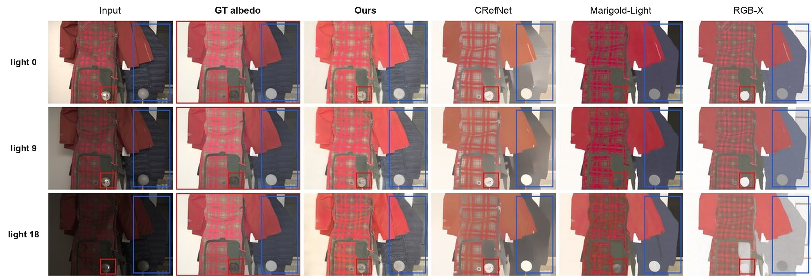
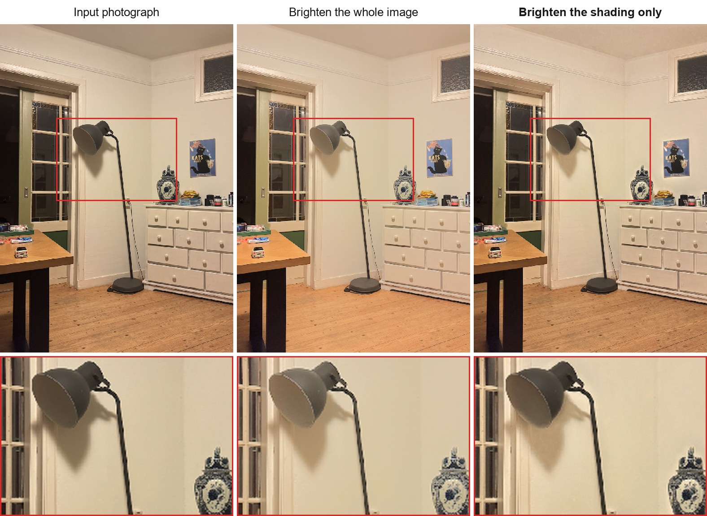
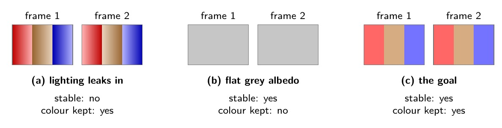
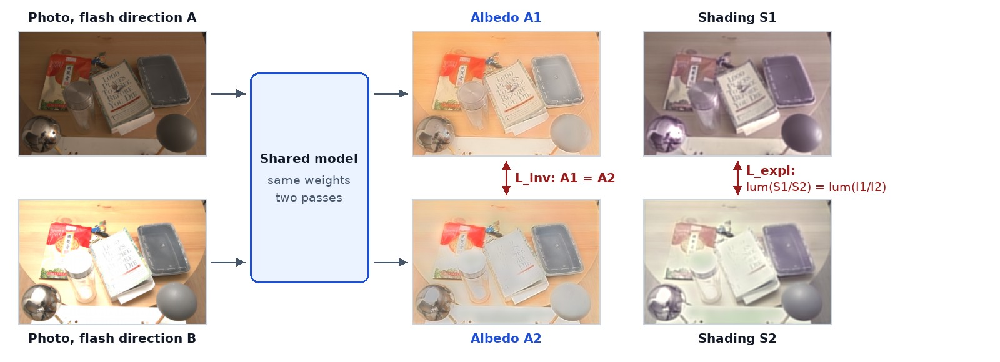
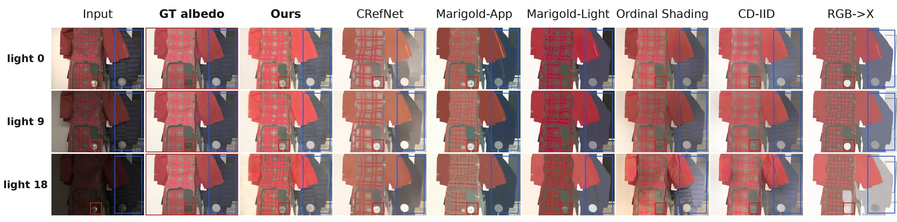
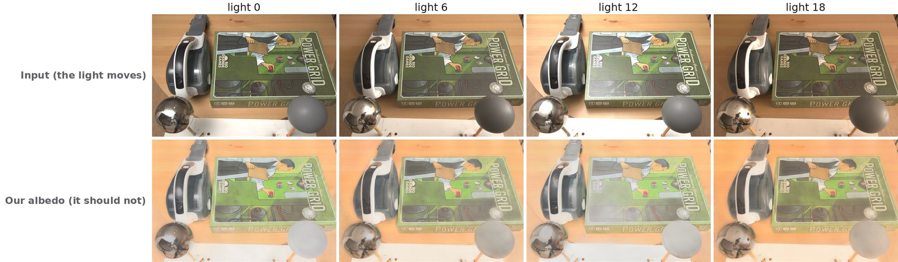
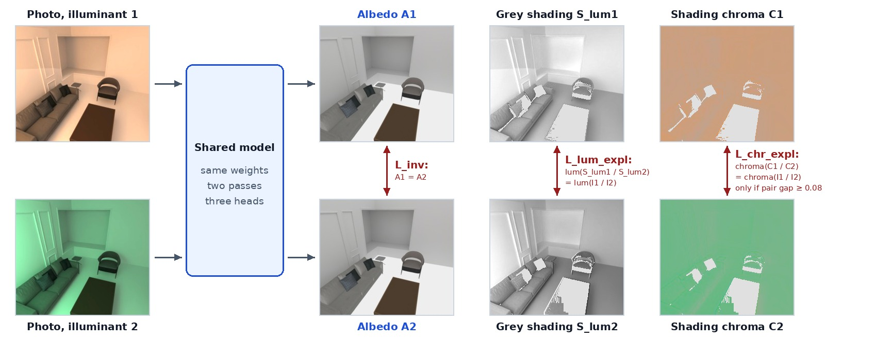

<div align="center">

# Luminance Constancy in Intrinsic Image Decomposition<br>via Cross-Illumination Albedo Invariance (CIAI)

**Train on two photographs of one scene under different lighting, and the albedo luminance changes much less with the light.**

**Minh Khang Tran** &middot; MSc thesis project, 2026

[](documents/thesis/Main.pdf)
[](https://tmkhang1999.github.io/CIAI/)
[](https://www.python.org)
[](https://pytorch.org)



</div>

**Figure 1.** One held-out scene under three flash directions. The surfaces do not change, so the albedo should not either. CRefNet and Marigold-Light shift in brightness as the light changes, and RGB-X, whose brightness is about as steady as ours on this scene, turns the blue jacket grey at light 18. Ours changes less, though it is paler than the ground truth. All seven methods are compared in Figure 5.

## Overview

- **Problem.** A single photograph cannot tell a dark surface from a dimly lit one, so part of the lighting leaks into the recovered albedo. The same wall can come out lighter or darker depending on how the room was lit. This work started from enhancing interior photographs, for example for real-estate listings, at 3DUniversum: brightening only the shading keeps the materials as they are, but only if the albedo holds no lighting (Figure 2).
- **Goal.** Predict, from one image, an albedo whose luminance stays the same when only the light changes, without losing the colour of the material.
- **Why it is hard.** Real photographs have no albedo ground truth. Stability alone has a trivial solution: a flat grey albedo never changes, but it is wrong (Figure 3). And the only real dataset with many lights per scene and a dense albedo reference, MID, uses a white flash, so its light colour barely changes.
- **Idea.** Two photographs of one scene under different lighting go through the same network. Their albedos must agree, and their shadings must explain the change in brightness. The pairs are used only in training, so inference is one image and one pass.
- **Result.** In a matched ablation, CIAI lowers the luminance variation of a material across lighting by **28% and 39%**, and the albedo error on raw ARAP renderings by **7-14%**, a benchmark never used in training.
- **Limit.** Hue drift improves only by 4-6%, because the explanation loss uses luminance only.

<div align="center">

</div>

**Figure 2.** Why a clean albedo matters. Brightening the whole image (middle) also lifts dark materials, so the dark lamp turns grey. Brightening only our predicted shading (right) lightens the shadow on the wall and keeps the lamp dark.

<div align="center">

</div>

**Figure 3.** Why stability must be read next to accuracy. A flat grey albedo (b) is perfectly stable, so CIAI has a second loss, and every stability score here is reported next to an accuracy score.

## Contributions

1. **A paired training strategy on real photographs.** MID pairs with pseudo-ground-truth albedo, added as a second training stage.
2. **A matched ablation** that isolates the effect of CIAI on luminance stability and on albedo accuracy.
3. **An evaluation that reports every stability score next to an accuracy score.**

## Method

<div align="center">

</div>

**Figure 4.** CIAI is used in training only. Two flash directions of one scene share one model.

The model is a frozen DINOv2-L encoder with a DPT decoder, an albedo head and a three-channel shading head (18.5M trainable parameters). A residual R = (I - A * S)<sub>+</sub> absorbs highlights. Training has two stages:

- **Stage A.** Supervised training on Hypersim and InteriorVerse, so the albedo has a reference colour before any pair is used.
- **Stage B (CIAI).** Training continues on pairs from the Multi-Illumination Dataset (MID), where every scene is photographed 25 times with a flash bounced in a different direction, with the pseudo-ground-truth albedo from [MIDIntrinsics](https://github.com/compphoto/MIDIntrinsics). The first frame of a pair is white-balanced and supervised; the second is left raw, so it keeps its own light colour. Two losses tie the pair:
  - `L_inv`: masked L1 between the two albedos.
  - `L_expl`: the log luminance ratio of the two shadings must equal that of the two images, which rules out a flat albedo.

The model also has a **colour path** (an RGB skip into the albedo head and a chroma loss), which keeps the albedo colour that the frozen encoder tends to wash out. It is a design choice of the model, not part of CIAI.

## Results

All MID numbers use the 30 held-out scenes with raw input. The ablation starts from one shared checkpoint with the same data and steps. The figures show the same model trained for 20k further iterations.

| CIAI | Colour path | C<sub>mat</sub> &darr; | Cast<sub>rel</sub> &darr; | MAW &Delta;E &darr; | ARAP raw LMSE &darr; |
|:---:|:---:|:---:|:---:|:---:|:---:|
| off | off | 0.250 | 0.477 | 4.43 | 0.0463 |
| on  | off | 0.180 | 0.447 | 4.63 | 0.0397 |
| off | on  | 0.259 | 0.444 | **4.12** | 0.0426 |
| on  | on  | **0.157** | **0.425** | 4.16 | **0.0396** |

**Table 1.** Matched ablation. C<sub>mat</sub> is the luminance variation of a material across lighting, Cast<sub>rel</sub> the relative hue drift. The last row is our model.

| Method | C<sub>mat</sub> &darr; | Cast<sub>rel</sub> &darr; | Chroma err &darr; | MAW &Delta;E &darr; |
|:---|:---:|:---:|:---:|:---:|
| **Ours** | 0.157 | 0.425 | 0.129 | 4.16 |
| CD-IID | 0.190 | **0.306** | **0.090** | **3.37**\* |
| RGB&rarr;X | **0.128** | 0.338 | 0.203 | - |
| CRefNet | 0.151 | 0.355 | 0.201 | 3.97 |
| Marigold-App | 0.193 | 0.355 | 0.195 | 3.78 |
| Marigold-Light | 0.546 | 0.392 | 0.154 | 4.21 |
| Ordinal Shading | 0.252 | 0.549 | 0.148 | 6.88 |

**Table 2.** Comparison with other methods. \* Value reported in the CD-IID paper.

<div align="center">

</div>

**Figure 5.** One held-out scene, three flash directions, seven methods. The red and blue boxes track the same two regions in every panel, so any change between rows comes from the model.

1. **CIAI improves luminance stability.** C<sub>mat</sub> drops by 28% and 39% in the two matched pairs. Our model is more stable than CD-IID, both Marigold variants and Ordinal Shading, level with CRefNet, and behind RGB&rarr;X.
2. **CIAI improves accuracy where the input carries its lighting.** On raw ARAP, albedo LMSE drops by 14% and 7%.
3. **CIAI does not improve measured colour.** Hue drift improves by only 6% and 4%, MAW &Delta;E does not improve, and CD-IID is better on all colour measures.

## Limitations

- **Colour is not learned.** The explanation loss uses luminance only, and the flash in MID is white, so the light colour changes only slightly between frames (median chromaticity gap 0.030). Hue drift therefore still grows with the light colour, nearly as much as in a grey-shading model.
- **Reflective surfaces and hard shadows.** A mirror cannot be written as albedo times shading, so its reflections move into the albedo as the light moves (Figure 6), and a sharp cast shadow can still be read as a material edge.
- **ARAP is a within-study comparison.** ARAP stores its ground-truth albedo in three encodings, and one fixed mask is applied to every model, so the ARAP numbers compare models with each other, not with published ARAP results.

<div align="center">

</div>

**Figure 6.** One scene under four flash directions (top) and our albedo from each photograph (bottom). Most surfaces stay the same, but the reflections in the mirror sphere change with the light, in the input and in the albedo.

## Future work

The next stage targets colour.

<div align="center">

</div>

**Figure 7.** Future pipeline. The output panels are ground-truth targets from a rendered 3D-Front scene (S = I / A), not predictions.

1. **Cross-architecture test.** Train with and without CIAI on a CNN, a fine-tuned ViT and a single-step diffusion model, with the same data and three seeds.
2. **Model.** Split the shading into a grey part and a chroma part, I = A * (S<sub>lum</sub> * C) + R (`src/models/trifactor_net.py`).
3. **Loss.** Add a chroma explanation loss on C, used only on pairs whose light colour really changes (`src/losses/trifactor_loss.py`).
4. **Data.** Rendered coloured-light pairs from 3D-FRONT with exact albedo (`scripts/render_3dfront_dataset_v2.py`, needs Blender 4.2), and real coloured-light pairs such as LSMI.

## Quick start

```bash
git clone https://github.com/tmkhang1999/CIAI.git && cd CIAI
conda create -n ciai python=3.10 -y && conda activate ciai
pip install -r requirements.txt
python tests/smoke_test.py          # one training step per config on random data, CPU, about 1 min
```

Pretrained weights are not released. After training (below), decompose a photograph with your Stage B checkpoint:

```bash
python tests/infer/infer_wild.py --image your_photo.jpg \
    --checkpoint checkpoints/ciai/checkpoint_iter_40000.pth --device cuda --max_size 1280   # or mps / cpu
```

## Training

Place the datasets next to this repository: `datasets/hypersim/`, `datasets/MIDIntrinsics/{train,test}/` and `datasets/IndoorInverseRendering/interiorverse/` ([Hypersim](https://github.com/apple/ml-hypersim), [MIDIntrinsics](https://github.com/compphoto/MIDIntrinsics), [InteriorVerse](https://interiorverse.github.io/)).

```bash
bash scripts/train.sh --config stage_a --cuda 0                  # Stage A, stop at 19k
bash scripts/train.sh --config ciai --cuda 0 --skip-optimizer   # Stage B (CIAI) from the 19k checkpoint
```

`ablation_none`, `ablation_ciai`, `ablation_colour` and `ciai` are the four ablation rows, and `ciai` is the reported model. All runs used one 24 GB GPU; a CIAI step runs two forward passes. The CIAI losses are in `src/losses/ciai.py` and take plain tensors, so any model that outputs an albedo and a shading can use them.

## Evaluation

```bash
CKPT=checkpoints/ciai/checkpoint_iter_40000.pth   # your Stage B checkpoint
python tests/eval/eval_mid_constancy.py --ckpts $CKPT --mid-root ../datasets/MIDIntrinsics --split test --save-json
python tests/eval/eval_maw.py --ckpts $CKPT --save-json
python tests/eval/eval_arap.py --checkpoint $CKPT --constancy
```

## Related work

CIAI follows Siamese representation learning and multi-view consistency: two views of one thing should share one property. Paired-illumination training for IID was proposed before, from time-lapse sequences (BigTime, Li and Snavely, 2018) and multi-illumination pairs (Lettry et al., 2018; Ma et al., 2018; Kinoshita and Kiya, 2022). CIAI differs in that it is a second training stage on top of supervised synthetic training in a modern feed-forward model, on raw real photographs with a pseudo-ground-truth albedo. CD-IID (Careaga and Aksoy, 2024) predicts the shading colour in a separate stage, which is the direction of our future work.

## Citation

```bibtex
@misc{tran2026ciai,
  title  = {Luminance Constancy in Intrinsic Image Decomposition via
            Cross-Illumination Albedo Invariance ({CIAI})},
  author = {Tran, Minh Khang},
  year   = {2026},
  note   = {Project report based on the author's MSc thesis (Erasmus Mundus
            Joint Master in Computational Colour and Spectral Imaging, NTNU)},
  url    = {https://github.com/tmkhang1999/CIAI}
}
```

## Acknowledgements

This work started as an MSc thesis supervised by Dr. Luis Gomez Robledo and Prof. Seyed Ali Amirshahi (COSI),
with Dr. Sezer Karaoglu and Prof. Theo Gevers at the host institution. It builds on
[DINOv2](https://github.com/facebookresearch/dinov2) and [DPT](https://github.com/isl-org/DPT), and uses
[MID](https://projects.csail.mit.edu/illumination/), [MIDIntrinsics](https://github.com/compphoto/MIDIntrinsics),
[Hypersim](https://github.com/apple/ml-hypersim), [InteriorVerse](https://interiorverse.github.io/),
[MAW](https://measuredalbedo.github.io/), [IIW](http://opensurfaces.cs.cornell.edu/intrinsic/) and ARAP.
Baselines: [Marigold-IID](https://github.com/prs-eth/Marigold),
[Ordinal Shading and CD-IID](https://github.com/compphoto/Intrinsic), RGB&rarr;X and CRefNet.
